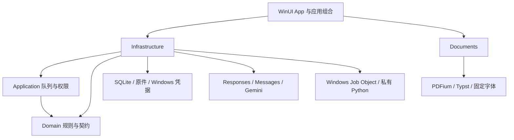

# Oh My Study 原生架构

更新：2026-10-18。正式工程为 C#，旧实现仅归档于忽略的 `.reference/`，不作为后端或构建输入。业务兼容与验收门槛见 [migration.md](../migration.md)，逐轮证据见 [migration-progress.md](../migration-progress.md)。以下区分当前实现与仍需验证的边界，不表示迁移验收已经关闭。

## 分层与组合

| 工程 | 当前责任 | 工程依赖 |
| --- | --- | --- |
| App | WinUI/XAML、窗口、导航、表示状态、选择器、原件对照、设置、任务和应用组合 | Infrastructure、Documents；经它们使用 Application/Domain |
| Domain | 资料、题目、来源、评分、配置、任务与协议模型，验证规则，源生成 JSON | 无其他业务工程依赖 |
| Application | 单任务队列、持久化/执行契约、权限批准绑定、任务取消和提交屏障 | Domain |
| Infrastructure | SQLite 仓储、资产、凭据、三协议 HTTP/SSE、整卷编排、Windows Job Object 与执行适配 | Application、Domain |
| Documents | 有界 LaTeX/mhchem 转换、Typst 排版、PDFium、坐标变换、字节预算缓存 | 独立服务 |
| Setup | 清单与文件校验、按用户版本目录、原子切换、开始菜单与卸载集成、失败回退 | 独立安装工程 |

App 当前直接组合具体仓储、队列、协议与文档服务；没有把计划中的抽象误写为已经实现的依赖反转。正式代码不使用旧 Rust 后端、Node 常驻服务、反射扫描注册或运行时代码生成。JSON 使用封闭的源生成上下文，WinUI 使用编译绑定和局部状态通知。

根目录采用解决方案、集中包版本、逐工程锁文件及统一 AOT/裁剪分析。`packaging/Invoke-MigrationChecks.ps1` 串行进行 Release 锁定还原、全新发布及 EXE 实际运行；`Test-RepositoryLayout.ps1` 检查旧实现隔离。只有编译成功或设置 `PublishAot` 属性不算 Native AOT 验证通过。

## 领域与整卷任务

Domain 已实现旧模型的严格/宽松 JSON 行为、枚举与可空项、整数范围、UTF-8 长度、来源坐标、评分一致性、教师优先、参考答案匹配、手改保护、空白卷与错题区别、递归小问及逐页覆盖。权限摘要按旧固定字段顺序和 UTF-8 字节计算，不以一般 JSON 格式替代。

`JobQueue` 保持一次一个运行任务，其余排队；快照和不可复用的递增事件共同持久化，重启处理中任务与取消有明确终态。提交屏障等待已在途提交收束，拒绝取消后的迟到结果，已成功保存的题目保留。App 最小化不停止队列，关闭时等待取消和资源释放。

`GradingRunner` 以整卷为上下文，组合 Responses、Messages、Gemini 原生协议与各自思考配置、SSE、工具回合、用量和价格记录。只有校验通过的工具结果进入仓储；参考答案任务限制自身工具与覆盖范围。三协议和三模式的合成链路经过真实队列、协议客户端及 SQLite；真实识别、漏题、串答和评分语义仍待授权供应商及样卷验收。

权限批准绑定代码、工具、参数、目录和超时，区分一次、本任务与拒绝；宿主执行使用 Windows Job Object 回收所属进程树。私有 Python 来自锁定运行时。`PolicyToolExecutor`按冻结许可分派宿主或Sandbox，后者每次调用创建独立VM，通过新`wsb` CLI明确指定随机会话ID，并只停止该ID。调用之间不保留任意环境状态；这是替代未完成旧原型的可证明归属生命周期。Windows 10、旧Windows 11或缺少CLI时不返回Ready；开始前可明确警告并冻结本机回退，Sandbox执行失败后没有宿主重放。真实会话、映射与系统矩阵仍由用户验收，不能将本机执行显示为沙箱隔离。

## 持久化与资料切换

`LibraryRepository` 用专用线程串行运行 SQLite，队列有界；媒体准备在另一个受限后台工作区执行。写事务在 COMMIT 前再次检查取消，提交成功后不因随后到达的取消误报未保存。支持 v1/v2 识别与事务升级、WAL、外键、资料/页序/方向、资产、供应商、设置、题目、参考答案、覆盖、模型调用及任务事件。

旧 SQL 固定副本位于 `tests/Fixtures/LegacyDatabase/`，生产迁移 SQL 为 Infrastructure 内独立资源；JSON 和协议夹具分别位于 Compatibility、ProviderProtocols。保留 ID、排序、资料模式的 JSON 文本、SQL/JSON 进度尺度、PDF 原页引用、原件字节，以及 `OhMyStudy/provider/<UUID>` 和 UTF-8 凭据 blob。

默认新库位于 `%LOCALAPPDATA%/OhMyStudy/Library`。旧目录解析仍指向 `%APPDATA%/io.ohmystudy.desktop`；`LibraryMigrationService`只读备份原库，恢复到新目录，仅升级副本，核对资料、题目、资产、凭据引用等指纹并写迁移收据。App在仓储、任务、设置和界面全部初始化后才原子切换库指针；中途失败释放会话并重新打开原库。不会自动就地升级用户旧库。此流程通过合成库测试，真实资料与目标安装身份由用户验收。

备份使用 SQLite online backup 包含 WAL，连同引用资产与 SHA-256 清单生成完整新目录；恢复校验后只落到不存在的新目录。可写连接用写事务冻结其他数据库写入；只读路径固定读快照，不改变源 schema。新版文件 lease 只约束合作实例，另有已知旧进程检查；它不能阻止改名旧程序、检查后启动或外部文件操作，不能被描述为旧新版可靠互斥。

凭据替换先写新目标，数据库失败则清理新目标，成功后再清理旧目标。Credential Manager 与 SQLite 没有跨系统事务；崩溃或清理失败可能遗留未引用凭据。自动测试使用合成 vault，不触碰真实密钥。详细恢复边界见 [P3](migration/p3-storage.zh-CN.md)。

## 阅读、导出与原生依赖

导入保留 PNG/JPEG/WebP/PDF 原字节，限制页数、字节数和像素；PDF 页与原件分开关联。App 原生媒体服务按需解码，通过公共坐标变换保持旋转后的原件与来源框一致，缓存按字节及分辨率层级控制。WebP 优先系统解码，缺少可用 codec 时使用固定哈希的私有 `dwebp`，无需用户另装图片扩展。

公式链路为 C# 有界 LaTeX/mhchem 转换 → 私有 Typst → PDF/SVG → PDFium。原生内容视图覆盖文字、公式、表格和来源图像；不支持的公式保留完整可读原式。A3/A4 PDF导出支持图像裁片、表格、选项和递归小问，题目与答案分开排版；缺图、无效内容或资源超限明确拒绝。文档回归生成8份45页PDF，包含分页、字体与复杂内容检查；这不等于M4复习卷或物理打印通过。原件打印只在用户点击后启动系统流程，物理打印由用户验收。

PDFium、Typst、SQLite、dwebp、字体和私有 Python 均有固定来源与哈希。WinUI传递的可选WebView2 interop文件单列记录，文件存在不等于浏览器进程被调用；当前产品没有浏览器控件或固定浏览器启动路径。离线候选包包含Native AOT安装器、完整portable目录、运行时、两个计算worker、依赖许可证、源码快照及逐文件清单，状态为`release-candidate-user-acceptance-pending`。

`OhMyStudy.Setup`按用户安装到`%LOCALAPPDATA%/Programs/OhMyStudy`，验证清单后写入独立版本目录，以原子活动指针升级；失败回退旧版本，提供开始菜单与卸载入口，卸载保留资料。安装器自身不依赖开发环境，本轮不执行签名；干净系统安装、升级、卸载与来源信任由用户验收，见[P9](migration/p9-release.zh-CN.md)。

## 原生编辑与状态

复杂编辑使用原生字段处理正文、公式、选项、表格、配图、来源和最多八层小问，标准答案、学生作答及教师批注保持独立。保存失败保留窗口与输入，保存期间新输入不会被较早的返回值覆盖；退出或切库对未保存草稿说明后果。视图按资料、页面和题库记录选择、滚动、缩放、焦点与光标，迟到的导航、题目呈现和任务刷新有代次检查；相同内容复用列表行。

## 证据与剩余门槛

本轮实际AOT回归包括Domain 107、Storage 93、Grading 211个断言，Provider 11个协议场景、Execution 17组、Media 26个检查和Setup 40项。App隔离库工作流28项通过，覆盖复杂编辑、保存竞争、资料切换失败恢复和阅读状态；Documents生成8份、合计45页PDF。样板桌面自检继续独立保留，不替代正式仓储流程或真实用户验收。

`output/migration/evidence/performance-final/summary.json`记录三次顺序启动P95为636.3232ms，空库自然空闲约104–106MiB，释放后约201–202MiB，略超200MiB；不能把采集完成算作预算通过。原始报告保留页面加载、Rendering回调、后台UI排队延迟、内存和GC计数曲线，全程不强制GC。Rendering并非GPU呈现或ETW；样本也不能直接命名为冷/热启动。干净Windows、安装升级/卸载、真实库与凭据、供应商语义、真实Sandbox、物理打印、DPI/读屏/输入法和参考设备性能均由用户负责，未标记通过。
