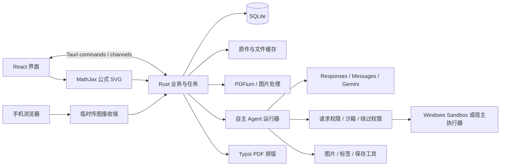

# Oh My Study 技术架构选型

状态：架构选型定稿，可据此实施。本文描述设计决定，不代表程序已经实现、兼容性已经通过或性能已经测量。

## 1. 架构决定

采用 **Tauri 2 + React + TypeScript + Vite + Rust + SQLite** 的本地桌面架构。前端编译为静态资源，业务与模型调用在 Rust 进程中执行。Python 随任务在 Windows Sandbox 或宿主机执行，不是常驻后端。

首版 Windows x64 原生运行。安装包包含计算运行时、字体、PDF 能力和排版资源。安装不需要联网下载组件；AI 请求仍需要访问用户配置的在线供应商。

| 职责 | 选型 | 决定理由 |
| --- | --- | --- |
| 桌面宿主 | Tauri 2、系统 WebView2 | Rust 业务与静态前端集成，避免额外常驻应用服务器 |
| 界面 | React、TypeScript、Vite | 用户指定；使用静态 SPA，不使用 SSR |
| 样式与组件 | Tailwind CSS、shadcn/ui、Radix、Lucide | 统一尺寸、排版与交互，只引入实际使用的组件 |
| 前端数据 | TanStack Query、React 本地状态 | IPC 查询缓存与局部界面状态，不再引入全局状态框架 |
| 页面导航 | React Router HashRouter | 静态资源部署，导航不依赖 HTTP 服务端回退 |
| 业务与任务 | Rust、Tokio、Serde、tracing | 任务、数据、进程与网络统一管理 |
| 模型网络 | reqwest + rustls、三套原生协议适配器 | 不把三种协议转换成 Chat Completions，不引入 Node 运行时 |
| 本地数据 | SQLite、rusqlite、SQL 迁移文件 | 无独立数据库服务，结构化查询、事务与备份足够 |
| 图片 | Rust image、按需缩放缓存 | 常用查看、裁图、旋转无需启动 Python |
| PDF 输入与预览 | PDFium、pdfium-render | 按页读取／渲染，以图片支持扫描 PDF；固定 DLL 与哈希 |
| 公式 | LaTeX 作为保存格式，MathJax SVG + mhchem | 兼顾数学与化学，预览和导出共用公式图形 |
| PDF 排版 | Rust Typst + typst-pdf、固定模板 | A3 双栏、A4、分页、留白与中文混排；不安装完整 TeX |
| 自由计算 | 应用私有 CPython + NumPy、SymPy、Pillow、Matplotlib | 自由 Python 绘图与核验，依赖随离线包固定提供 |
| 执行环境与权限 | Windows Sandbox + 宿主执行器 + 应用权限确认 | 三种用户可选模式；沙箱不可用时警告并允许宿主执行 |
| 密钥 | 操作系统凭据存储，Rust 访问 | 配置与密钥分开，模型密钥不交给计算子进程 |
| 手机传图 | Rust axum 临时局域网接收端 | 用户开启时才监听，扫码上传后关闭 |
| 分发 | NSIS x64 离线安装包 | 面向 Windows 普通用户，支持安装、更新和卸载 |

开发时锁定稳定版本并提交 Cargo.lock、前端锁文件和 Python 依赖锁定清单。此处不编造未来安装时的补丁版本。

## 2. 组件关系

网络供应商调用、数据库写入、路径访问和进程执行均由 Rust 管理。前端没有通用 shell 或数据库权限。图片等大文件通过文件引用传输，不把整批材料常驻在 React 状态中。

## 3. 界面结构

主导航为“导入与批改、题库、错题、复习卷”，设置位于导航底部，任务进度以抽屉展示。

- 导入：拖入文件、调整页序、选择“已有教师批改／待 AI 批改／空白试卷”、附加参考答案、选择供应商／模型／思考选项后开始。
- 批改结果：左侧原始材料，右侧题目和批改；可跳到来源区域、修改内容、重新批改，不要求先逐题审核才能入库。
- 题库／错题：紧凑列表与详情，支持学科、知识点、来源、日期、题型筛选；答案与解析按需展开。
- 复习卷：手动勾题或按最近 N 天选题，选择复现／巩固，生成后进入实际 PDF 预览。
- 模型设置：供应商下维护模型列表；任务页直接选择模型和它实际支持的思考参数。
- 权限设置：用户可选择请求权限、沙箱运行或绕过权限；任务页持续显示实际运行环境，沙箱不可用的本机执行有清楚警告。

视觉采用浅色中性色、单一强调色、清晰字号层次、细边框和适量留白，避免到处放统计卡片。界面使用系统中文字体；排版引擎使用可分发的固定字体。

## 4. 本地数据模型

| 实体 | 主要内容 |
| --- | --- |
| source_documents / source_pages | 导入类型、名称、学科、日期、原件、页序、尺寸与旋转信息 |
| questions | 本次导入独立题目、类型、题干、选项、小问、配图、答案、解析、分值与来源 |
| attempts | 作答文本／区域、得分、小问结果、错误原因、未作答标记、评分来源、原始教师批注与冲突说明 |
| tags / question_tags | 学科内知识点和题目关联；唯一规范名称与合并后的关联 |
| papers / paper_items | 复习卷设置、题目内容快照、排版参数、答案册与输出 PDF |
| providers / models | 协议、地址、密钥引用、模型 ID、能力、思考设置、定价配置 |
| jobs / job_events / model_calls | 任务状态、简短工具进度、原始用量、估算费用与错误信息 |
| assets | 原件、裁片、Python 产物、公式 SVG、预览的类型和文件位置 |

题目内容使用版本化 JSON 结构，包含文字、公式、表格、图片引用和小问。这里的版本指内容格式版本，不是用户修改历史。学科、日期、类型、来源等筛选字段和标签关系使用 SQL 列。

题目和作答的来源允许引用多个页面区域。区域坐标使用原始页归一化坐标，并保存旋转／裁图变换，避免预览缩放后指向错误位置。

不合并不同导入产生的题目。一次任务内部的保存工具使用稳定草稿键保证重复调用不会重复插入；重新导入属于新的独立数据。

空白卷只录入题目，不创建未作答记录。已作答卷根据批改结果建立作答记录；错误、部分正确及未作答进入错题，无法判定的结果保留标注并默认排除。

评分来源区分教师批改、AI 按参考答案评分、AI 自行解题评分、用户手动修改。教师模式中保留原有标记与评分，AI 仅补充缺少的判断和解析；已有明确教师结果不会被 AI 重批覆盖。识别到扣分但满分不明确时保存原始扣分证据，估算分值明确标注。

用户修改直接更新当前内容；手动修改评分后立即重新计算错题筛选结果。卷子保留生成时的内容快照，避免后续编辑让已经导出的 PDF 与预览内容不一致。

## 5. 搜索与知识点

知识点按学科隔离。Agent 先查询现有标签，优先引用标签 ID，再在确有需要时创建新标签。规范化去除空白差异，SQL 唯一约束阻止完全重复；语义同义由 AI 参考与用户合并解决，不引入向量数据库。

改名修改标签本体；合并在事务内迁移关联、消除重复关系，并让运行中的旧标签引用解析到合并结果。

题目搜索使用 SQLite FTS5 trigram，少于三个字符的中文查询回退到参数化 LIKE；标签和来源使用普通索引。首版不加入 embedding、外部搜索服务或额外常驻进程。

## 6. 三种原生模型协议

统一的是任务输入、工具定义、进度事件和用量记录；每个适配器保留供应商原始的内容块和工具往返上下文。

| 协议 | 接口 | 思考配置原则 |
| --- | --- | --- |
| OpenAI Responses | POST /v1/responses；GET /v1/models | reasoning.effort 按模型能力给出可选值，不把所有值发给所有模型 |
| Anthropic Messages | POST /v1/messages；GET /v1/models | 区分 adaptive thinking + output_config.effort 与旧模型 budget_tokens，按能力显示 |
| Gemini Generate Content | POST /v1beta/models/{model}:generateContent 或 :streamGenerateContent；GET /v1beta/models | generationConfig.thinkingConfig 中区分 thinkingLevel 与 thinkingBudget，按模型支持选择一种 |

供应商可配置自定义地址、协议和必要请求头。模型列表支持分页刷新、缓存和手动模型 ID。优先采用 API 返回的能力，其次使用随版本维护的能力表；未知模型允许人工配置和主动测试，不能仅根据模型名称猜测。

“可选任意模型”表示不做品牌或型号白名单。整卷视觉任务仍须有视觉及工具调用能力；不兼容时明确说明缺少的能力，不偷偷换模型、改协议或删除思考参数重发。

Responses 的 reasoning output items、Anthropic 的 thinking/signature blocks、Gemini 的 thought signatures 在工具循环中保留；不能统一压成普通文字后再发送。UI 只显示可见进度、结果和供应商公开返回的摘要，不依赖取得原始内部推理文本。

用量保存供应商原始 usage 和规范化字段。输入、缓存读取／写入、输出、思考计数按协议规则解释，避免把已经包含在输出中的思考 token 再计费。每次调用保存当时的价格快照；未设置价格显示“费用未知”，不显示零元。不同币种默认不强行换算。

## 7. Agent 组织与工具

| 任务 | 方式 |
| --- | --- |
| 已有教师批改整卷 | 一个整卷自主 Agent，提取教师结果与学生作答，补充解析；未明确标记的题由 AI 补充判断并注明来源 |
| 待 AI 批改整卷 | 一个整卷自主 Agent，按需查看材料、参考答案和题图，直接产生整卷题目及批改结果 |
| 空白整卷录入 | 独立指令与任务上下文，提取题目，不制造作答 |
| 参考答案整理 | 独立任务；关联用户选定的材料，按题号和内容匹配 |
| 巩固卷 | 自主选取错题知识点、生成新题并用 Python 绘图；独立上下文的模型调用负责解题校验 |
| 标签建议、简单修正 | 已有上下文足够时单次 API |
| 原题复现与 PDF 排版 | 确定性本地逻辑，无需 AI |

共享运行器、协议层、文件服务和工具实现；不复用不同任务的业务 Agent 上下文。只有整卷入口，不创建单题 Agent，也不在整卷处理中逐题委派 Agent。

常用工具为 list_pages、read_image、crop_image、rotate_image、query_tags、read_references、python、shell，以及受任务范围约束的保存与 finish。Python 使用 NumPy、SymPy、Pillow 和 Matplotlib 完成计算、几何图及函数图，不另造一套绘图 DSL。

finish 验证输入页均已考虑、来源引用有效、得分没有越界、小问合计一致、未作答／无法判定标记没有混淆。验证失败把具体问题返回 Agent 修正，不把缺题结果伪装为完成。

题目材料和 Python 输出只是证据，不能覆盖任务指令。执行器不向计算子进程注入模型密钥或数据库句柄；是否阻止它直接访问其他宿主数据，取决于最终选定的系统访问策略。

## 8. Python、权限与 Windows Sandbox

采用 WindowsSandboxExecutor、HostExecutor 和 PermissionBroker 三个组件。支持且就绪时默认 Windows Sandbox；不可用时依用户要求允许本机执行并警告，不伪装为仍在沙箱内执行。请求权限与绕过权限是用户可选的宿主执行方式，不自动提升 Windows 用户权限。

请求权限模式逐次展示 Python 代码或命令、工作目录与宿主执行提示，支持仅本次／本任务允许或拒绝；批准绑定到实际调用内容。沙箱模式在隔离环境内执行，不逐次确认。绕过权限模式不弹出操作确认，不增加文件／网络权限限制；超时、输出限制与取消属于任务稳定性控制，不是文件权限沙箱。

兼容基线使用 .wsb 配置、LogonCommand、应用自带的沙箱内 runner 与文件交换桥接。运行时、输入和请求目录只读映射，独立的结果目录可写映射，宿主不把用户目录、题库数据库或密钥存储映射进去。只有经过校验的图像和结构化结果进入题库。

Windows 11 24H2 以后的 wsb CLI 可作为能力增强，但不作为 Windows 10 的先决条件，也不假定它提供标准输入输出直通。默认沙箱禁网、禁剪贴板和音视频／打印机重定向，关闭不需要的 vGPU，内存初值 2048 MB；在线模型调用留在宿主。

计算运行时随离线包提供，Matplotlib 固定使用 Agg，字体完整可用。Windows 命令使用 PowerShell 或明确可用的可执行程序，不假定 Bash 已安装。任务结束停止本应用拥有的沙箱／进程，不接管或关闭用户另行打开的沙箱。

沙箱的版本、功能启用、虚拟化、会话独占、窗口出现、启动耗时和终止语义先在 M0 验证。详细状态、模式回退、桥接与批准规则见 [执行与权限设计](execution-permissions.zh-CN.md)。未来 macOS / Linux 通过 Executor 接口扩展，不把 Windows Sandbox 描述为跨平台实现。

## 9. 图像与 PDF 的资源策略

- 原始图片和 PDF 保留一份；相同字节文件可共享文件存储，不因此合并题目记录。
- 一次只解码少量页面，按可见页与 Agent 需要生成预览／裁片，不一次把 12 张原图全部解压进内存。
- 低分辨率预览用于浏览，模型看细节时按需裁取原分辨率区域。小字、分式和化学式不能只看缩略图。
- PDFium 和 Typst 执行放在后台工作线程或可结束的辅助进程，不阻塞界面。
- Python 线程数限制为合理小值，不启动常驻 notebook、浏览器或独立模型服务。Windows Sandbox 仅在需要执行时启动，同一任务内复用，任务结束释放。
- 派生预览、公式与处理中间文件有大小限制和清理入口；原件和最终用户数据不会作为缓存清理。

## 10. 复习卷与排版

最近 N 天按本地日历日期计算，界面显示实际起止日期；默认以作答记录入库日期为准，可编辑作答日期。1 天包括今天，7 天包括今天及前 6 天。题库录入时间和试卷印刷年份不混用。

自动选题可以按学科限定；跨学科结果默认分学科建卷。复现卷可以确定性选取范围内错题；巩固 Agent 通过分页查询查看错题，围绕错误原因、知识点、题型和难度决定新题分布。

巩固题带参考答案、解析、知识点和生成来源。校验调用使用新上下文，先独立解题再核对答案；不要求另一个供应商，也不以多次一致代替正确性。不能凑齐有效题目时保留草稿并说明，不悄悄把少题卷标为完成。

PDF 使用固定 Typst 模板，题目内容以数据传入，不把 AI 生成的整段源码直接当打印模板执行。A3 横向双栏、A4 纵向单栏，支持题序、字号、留白和分页，题目卷与答案解析独立。

公式在 WebView 中用 MathJax 生成自包含 SVG，再交 Typst 排版；二者共用同一份公式图形，避免另写 LaTeX 到 Typst 的转换器。保存 SVG 尺寸和基线，第一阶段必须验证分式、上下标、中文和化学式的行高。

复杂结构式和实验图可使用原图裁片；新几何图和函数图由 Matplotlib 输出，文字与字号按打印尺寸验证。图形导入时去除外部引用和脚本。首版实验图使用文字描述；自动联网找图若需要，另加明确搜索／下载能力。

预览显示最终 PDF 的页渲染。点击打印交给系统 PDF 查看器／打印流程，避免 HTML 预览与导出 PDF 各排一遍产生差异。

## 11. 任务、备份与退出

任务状态为 QUEUED、RUNNING、WAITING_PERMISSION、COMPLETED、FAILED、CANCELLED、INTERRUPTED。全局一个 AI 任务运行，内部按需读取页面和调用工具。请求权限期间不继续执行后续调用。API 429／暂时网络错误少量退避重试；认证、余额、参数不兼容立即给出原因，不无限重试。

成功提交的题目与结果保留，取消后拒绝迟到的保存。退出停止网络与子进程，下次显示被中断的任务；不做托盘常驻和通用 Agent 会话断点恢复。

SQLite 使用 WAL 和外键，数据库访问放在专用工作线程。备份使用一致数据库快照与资产清单打包，不直接复制正在写入的 WAL 数据库。恢复前校验版本和文件完整性，恢复失败保留现有数据。备份不含 API 密钥；恢复后重新配置密钥。

## 12. 分发、资源与许可证

完整离线安装包包含应用、PDFium、CPython 与计算包、打印字体、MathJax 资源和缺失时可用的 WebView2 离线安装组件。用户已接受超过 200 MiB；压缩包、安装后本体、Python 包与共享 WebView2 分开测量和报告。

空闲约 300 MiB、本机执行常规处理峰值约 1 GiB 是待实测目标，统计 Rust、WebView2、Python 和相关辅助进程。Windows Sandbox 内存配置初值 2048 MB，沙箱模式的虚拟机／系统占用另行测量并与宿主合计报告，不沿用 1 GiB 总峰值承诺。对 12 张高分辨率输入测量，不能只测空窗口或忽略虚拟机。

离线包包含应用和计算依赖，不重新分发 Windows Sandbox 系统组件。启用系统功能、准备系统安装源／更新及重启由用户在操作系统中完成；不能把沙箱未就绪作为应用或本机执行模式的安装失败。

项目采用 GPL-3.0-or-later；逐项核查原生 DLL、Python wheel、字体及 JS/Rust 依赖，保留版权与许可，不认为 GPL 可以自动兼容所有依赖。复用参考项目代码时保留其 MIT 声明。用户样卷不作为公开仓库的测试资产。

## 13. 对照参考项目

复用：结构化题目、小问、来源区域、工具结果携带真实图片、原题内容快照、明确任务完成条件。

重新实现：本地 SQLite、Rust 原生协议、Windows 执行器、React 静态桌面界面、AI 新题生成与离线安装资源。

不引入：学校／班级／教师权限、账号服务、排名、双评仲裁、PostgreSQL、Qdrant、Web 服务部署、独立常驻 Worker、Linux Bubblewrap 依赖。

## 14. 已核对的主要官方资料

- [Tauri 前端配置](https://v2.tauri.app/start/frontend/)、[Windows 分发](https://v2.tauri.app/distribute/windows-installer/)。
- [OpenAI Responses](https://developers.openai.com/api/reference/responses/overview)、[思考模型](https://developers.openai.com/api/docs/guides/reasoning)、[模型列表](https://developers.openai.com/api/reference/resources/models/methods/list)。
- [Anthropic Messages](https://platform.claude.com/docs/en/api/messages/create)、[Thinking](https://platform.claude.com/docs/en/build-with-claude/thinking)、[模型能力](https://platform.claude.com/docs/en/api/models/list)。
- [Gemini Generate Content](https://ai.google.dev/api/generate-content)、[Thinking](https://ai.google.dev/gemini-api/docs/generate-content/thinking.md)、[Models](https://ai.google.dev/api/models)。
- [SQLite FTS5](https://www.sqlite.org/fts5.html)、[rusqlite 备份](https://docs.rs/rusqlite/latest/rusqlite/backup/index.html)。
- [MathJax SVG](https://docs.mathjax.org/en/stable/output/index.html)、[SVG 缓存](https://docs.mathjax.org/en/v4.0/options/output/svg.html)、[Typst 页面](https://typst.app/docs/reference/layout/page/)、[图片](https://typst.app/docs/reference/visualize/image/)。
- [Python Windows 嵌入式分发](https://docs.python.org/3/using/windows.html)、[Matplotlib 许可](https://matplotlib.org/stable/project/license.html)。
- [Windows Sandbox](https://learn.microsoft.com/en-us/windows/security/application-security/application-isolation/windows-sandbox/)、[安装条件](https://learn.microsoft.com/en-us/windows/security/application-security/application-isolation/windows-sandbox/windows-sandbox-install)、[配置](https://learn.microsoft.com/en-us/windows/security/application-security/application-isolation/windows-sandbox/windows-sandbox-configure-using-wsb-file)、[CLI](https://learn.microsoft.com/en-us/windows/security/application-security/application-isolation/windows-sandbox/windows-sandbox-cli)。
- [GNU 许可证兼容性](https://www.gnu.org/licenses/license-compatibility.en.html)。
