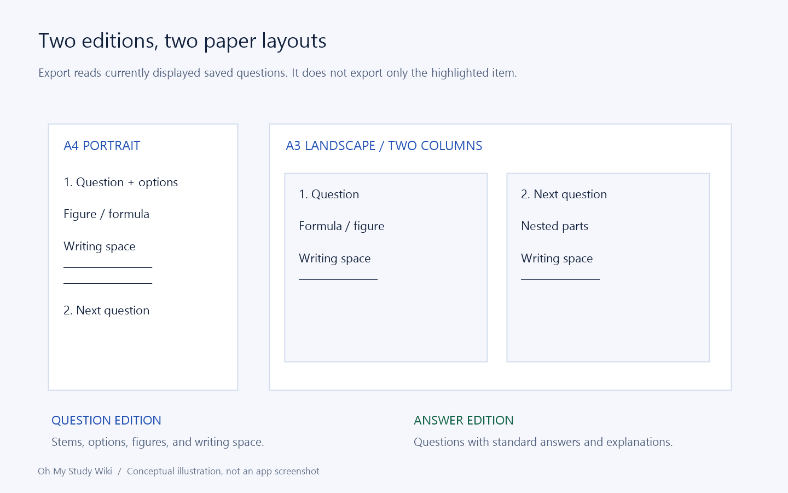

# PDF editions, page layouts, figures, and formula checks

[Home](Home.md) · [Feature Guide](Feature-Guide.md) · [简体中文](Features-Export-zh-CN.md)

## Define the export scope

Open the exam, bank, or mistake list that contains the intended material. Save edits, start Export questions, and read the question count. The export takes currently displayed saved questions, including their items, not just the row with focus.

The service supports 1–500 top-level questions and additional text/image budgets. A large collection can need multiple exports even if every individual question is valid.

## Choose an edition

| Edition | Includes | Intended use |
| --- | --- | --- |
| Questions | Question blocks, options, figures, items, optional writing space | Practice without displaying the answer key. |
| Answers and explanations | Questions with standard answers and explanations | Checking and guided review. |

Student-attempt text is not the answer key. A recognized answer still needs human review before the answer edition becomes trustworthy. Export numbering is sequential. Each question starts with its number, score in parentheses, and stem on the same line; original printed numbers are omitted. Parts use consecutive parenthesized numbers on separate lines without blank lines between them.

## Choose a paper layout

A4 is portrait with one column by default; A3 landscape defaults to two columns. You can choose one to four columns independently of paper size. Every page has ruled Class, Name, and Student no. fields in its header. Question spacing is compact. Four options use one row when they fit, otherwise two rows of two, or one option per row when necessary. The image illustrates their organization, not the exact pagination of your question set. Longer questions, large diagrams, and mathematical expressions affect breaks.

Produce separate question and answer files rather than expecting one export to create both. The save dialog defaults to the exam name as the PDF filename; you can change it before saving. Printing itself happens in a PDF reader, where printer paper/scaling must also match your intention.

PDF layout removes extra spaces between Chinese text and inline formulas while retaining English word spacing and explicit spacing inside formulas. Stored question text remains unchanged.

## Optional answer space

Both answer-space options are off by default. Enable **Include answer space** to reserve writing areas for subjective questions and subjective parts; choice and fill-in questions receive no extra space. The minimum height uses the standard answer length, explicit line breaks, score, and column width: about one handwriting line per two points, with seven millimetres per line and a normal range of 14–98 mm. Answer text is never printed on the question paper.

Enable **Distribute remaining space evenly** to share unused space in each page or column equally among its writing areas after the minimum-height layout. This option is available only when answer space is enabled. Both options apply only to the question edition.

## Handle figures responsibly

Image blocks use managed generated images when provided, otherwise crops from managed source pages. Check that the crop includes axis labels, units, and legends without bringing in neighboring answers. The export deduplicates identical decoded image payloads and enforces an aggregate budget.

Question-edition export blocks figures marked as handwriting-containing, including items. This prevents knowingly carrying student work into a clean practice sheet. A false flag does not clean pixels: use a source region that actually lacks the unwanted writing. If no clean source exists, revise the content deliberately rather than claiming the app removes handwriting.

## Check formula fallbacks and failures

Supported LaTeX renders into print assets; unsupported or oversized formulas can retain their source with a warning. A successful PDF write does not prove formula fidelity. Inspect fractions, minus signs, roots, superscripts, matrices, and line/column breaks.

If export fails, save edits first, verify regions and handwriting, reduce the batch, and check the destination. Missing/damaged local tools require package repair or full re-extraction. Local export does not call a model or spend model tokens.

Implementation and reference: [MainWindow.Documents.cs](../../src/OhMyStudy.App/MainWindow.Documents.cs) · [TypstDocumentService.cs](../../src/OhMyStudy.Documents/TypstDocumentService.cs) · [ExamDocument.cs](../../src/OhMyStudy.Documents/ExamDocument.cs)

---

[Previous chapter](Features-Tasks.md) · [Section contents](Feature-Guide.md) · [Next chapter](Features-Library.md)
