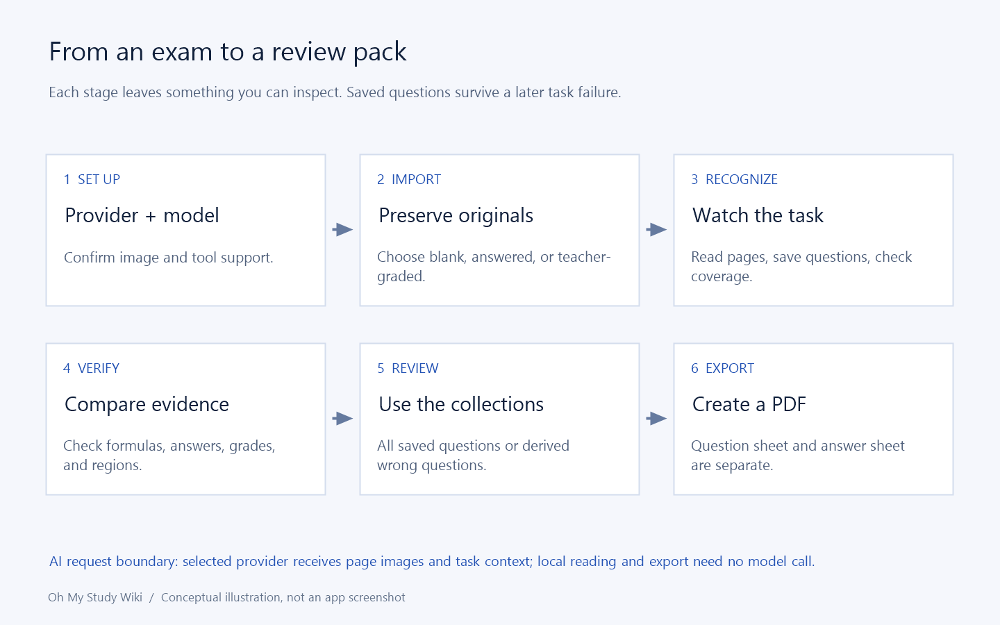

# 导入模式、限制与原件页面管理

[首页](Home-zh-CN.md) · [功能详解](Feature-Guide-zh-CN.md) · [English](Features-Import.md)

## 上传前准备

先自行打开，解密加密 PDF，检查页序、小字、笔迹。支持 PDF、PNG、JPEG、WebP；不支持的办公文档应先在原应用转换。

限制分层：试卷、学生作答附件与参考共 12 页、单文件 64 MiB、批次 256 MiB、图片 4,000 万像素，派生图片也有处理预算。小 PDF 仍可能超页数，单页图仍可能超尺寸。

## 直接使用手机拍照

在“导入试卷”“添加参考答案”或“上传学生作答”中选择“手机拍照”。手机与电脑连接同一 Wi-Fi，用手机相机扫描电脑显示的二维码，即可直接进入拍摄页面，无需安装 App、登录、输入 IP 或配对码，也可以复制连接链接。电脑提供两种连接方式：**连续拍摄（实验性 HTTPS）**使用网页内取景，**系统相机与文件（HTTP）**使用手机自带相机和文件选择器。

拍摄界面保持选择“拍多页”并连续点击快门，照片按拍摄顺序在手机端排队，不会立刻上传，也无需等待校正；“拍单页”在拍摄一张后直接进入预览。拍完后点击“最近扫描”或取景区缩略图，原图直传电脑生成本地预览，再在大图浏览中翻页、对比原图、选择滤镜、裁剪旋转、调整可选 DocRes 设置，或点击“继续拍”回到相机；点击“页面”可集中查看所有结果，勾选要保留的页面并删除其余页面。处理失败会保留原图，可以重试或取消勾选；取消处理也会保留队列。点击一次**发送 (N)**批量确认，再到电脑点击“导入”，后续仍按原有流程确认供应商与费用。照片与 PDF 在确认前都不会进入可导入列表。拍摄原图和校正后的页面会分别保存在资料库中。请保持手机页面打开：刷新会丢失尚未传输到电脑的照片，已传输草稿可在同一会话内恢复。

临时接收服务只监听选中的电脑网络，二维码包含随机会话凭据，有效期为 20 分钟，关闭窗口即停止两个接收入口。**连续拍摄（实验性 HTTPS）**需要浏览器信任的安全上下文，因此电脑会为所选局域网私有 IP 签发一小时有效期的证书，由已公开的 eMudhra EM OV TLS CA - G3C 中间证书签发，并固定 SHA-256 为 `7485B51C0ED192878FA1D2F948FB529AE1842CC5086C4B67F7BE5B2039DE9489`；它不安装根证书，也不修改浏览器校验。该受损证书链仅供实验：当前 Chromium 实测拒绝，手机也可能因撤销或证书透明度要求被拦截，因此无法在不可信网络上可靠证明服务器身份。若无法打开，请选择**系统相机与文件（HTTP）**后重新扫码；HTTP 保留系统相机和文件选择，仅建议在可信网络使用。处理在电脑本地执行，使用随包附带的本地 CPU 模型，权重合计约 45.7 MB：DocScanner-L 展平弯曲页面，方向模型把横拍或倒拍照片转正。标准处理会先识别四角并裁剪，再自动转正；无法可靠识别时保留整张照片。现有页数、单文件和批次限制仍然适用，原图与处理后的图片都计入预算。多个 PDF 即使文件数少于 12，也可能超过页数限制，最终导入时会验证实际页数。

若扫码后无法连接，可在上传前切换电脑网络，保持电脑唤醒；若 Windows 提示，请允许 Oh My Study 在专用网络上通信。访客 Wi-Fi 可能隔离设备，也可以使用手机热点将两台设备接入同一网络。部分扫码内置浏览器限制拍摄，可在 Safari 或 Chrome 中打开链接。修复可以改善轻微书页弯曲与失焦，但无法重建缺失细节；严重模糊、反光或折叠页面应重新拍摄。

## 模式是评分契约

自动识别由模型根据页面图片和已保存作答判断空白、已作答或已有教师批改，再按对应规则处理。已明确材料类型时可指定模式。

空白模式提取题目并生成标准答案与解法，不创建学生作答，即使有参考答案。已作答模式保留作答并区分实际空白与无法辨认。教师模式优先明确教师结果，未知部分才用 AI。对于错误或部分正确的作答，模型在证据充分时单独报告错因分析，无法判断时留空。

导入后，在试卷中使用“更多 → 上传学生作答”添加作答照片或 PDF，也可以在题目页通过“录入学生作答”输入单题的作答过程，再重新识别试卷。新增作答匹配已有题目键，保留原题与标准解法。空白卷补充作答后切换为自动判断，以便模型批改。手动录入作答受到保护，修改作答会清除旧评分和错因分析。

模型也可以报告试卷上可见的标题；没有标题时保留导入名称，重新识别不会覆盖用户手动修改的标题。

识别时，题号与小问标号单独保存，不再重复写在题干或小问正文开头，以便工作区和导出 PDF 只显示一次。正文中的数字、题目引用和选项标号仍予保留。此次提示词调整适用于后续识别，不会改写已经保存的题目。

例如红笔扣分符号缺少上下文时，不应凭空变成数值评分。满分未知不能捏造得分。参考答案用于证据匹配，不允许覆盖明确教师结果。

## 本地文档修复

标准处理默认依次启用：角点识别并裁剪 → 自动转正 → 去阴影 → 轻度去模糊 → 外观增强。**识别四角并裁剪**使用本地角点模型；无法可靠识别时保留整张照片。拖动手柄后，该页改用手动四角；“保留整张照片”会关闭裁剪。**DocScanner 去弯曲**和灰度默认关闭，仍可独立选择。打开拍摄设置或主预览页的**文档修复**，开关会作用于所有未发送照片（包括未勾选页面）及后续新照片；关闭设置后统一重建预览。已发送页面和 PDF 不受影响。修改全局开关会保留已有手动四角和旋转；“全部关闭”也会重置旋转。单页微调仍可在**裁剪旋转 → 文档修复**中进行。原图会单独保留；发送前请核对浅色笔迹和数学内容，严重模糊、反光及缺失细节仍需重新拍摄。

只有当单张 NVIDIA 独立显卡的专用显存严格大于 12 GiB，且已安装的 CUDA 运行时能初始化同一物理设备时，电脑端手机导入窗口才允许安装可选 **DocRes**。恰好 12 GiB 不符合要求；多卡显存不相加。驱动版本提示、CUDA 目录或共享内存都不能代替运行时验证。主动点击电脑端的**下载并安装 DocRes**后，才下载总计 896,242,296 字节（约 855 MiB）的模型权重，以及另需数 GB 的独立 Python/PyTorch CUDA 运行时。对话框显示每次下载的进度条，同样的进度写入日志，可取消安装，启动应用不会自动下载。安装通过校验值及实际 CUDA FP32/FP16 推理自检后才就绪；还需单独启用，随后在手机端选择 DocRes。上述处理均在本机执行，不向供应商上传照片。

DocRes 直接接收原始编码照片，默认全选四项官方推理任务：展开去弯曲、去阴影、外观增强和去模糊。每项仍可关闭；发现边缘拉伸时可关闭去弯曲。应用不会在 DocRes 前后附加角点定位、透视裁剪、DocScanner 校正、额外边框、灰度转换或其他增强；未勾选任何任务时保留原图内容，不调用 CUDA。标准处理选项与 DocRes 路径相互独立。外观增强可能改变浅色笔迹，应先检查预览。图像尺寸处理与推理遵循官方任务实现，应用不额外分块或混合拼接。CUDA 显存不足或模型失败后，可选择**标准（DocScanner + OpenCV）**后重试；取消处理不会确认或替换页面。

DocRes 下载单独保存在 `%LOCALAPPDATA%/OhMyStudy/DocRes`。关闭启用选项后停止使用，但不删除已下载文件。需要兼容的 NVIDIA 驱动和已安装且可用的 CUDA 运行时，应用不会安装全局 CUDA 工具包。

DocScanner 作者为 Hao Feng，使用单独的非商业许可证，要求署名和相同方式共享；商业用途必须提前取得作者书面许可。内置 ONNX 模型将上游 U2NETP 掩码与 12 次迭代 DocScanner-L 组合，并输出归一化反向网格。许可证与修改说明随软件提供在 `native/scanner/DocScanner-LICENSE.md` 和 `DocScanner-NOTICE.txt`。DocRes 使用 MIT 许可证。开发准备方法见[安装说明](../installation.zh-CN.md)。

## 保存什么

导入复制原件到受管理资源，准备本地页图/缩略图，识别另行执行。外部文件断开不影响库内副本，但删除试卷会删除该副本。

PDF 页面保留原资源与原页号关系。旋转/排序写为元数据，不改写外部 PDF。

## 导入后管理页面

打开试卷 → 更多 → 管理页面，上下移动或左右旋转，检查后保存。只能删除未引用页，至少留一页。

引用包括题目来源、配图、学生区域、教师证据、小问、答案来源。被阻止时应检查该页用途，绕过会破坏定位。更改结构前结束处理任务。

## 识别没有完成

查看任务，不反复导入。原件已存与任务失败/取消可同时成立，修正错误后重识别，保留已有成果。源材料确有缺陷时获取更清晰副本，并在替换或重处理前安排编辑保护。

实现与参考: [MainWindow.Library.cs](../../src/OhMyStudy.App/MainWindow.Library.cs) · [LibraryAssets.cs](../../src/OhMyStudy.Infrastructure/Storage/LibraryAssets.cs) · [MainWindow.Documents.cs](../../src/OhMyStudy.App/MainWindow.Documents.cs)

---

[上一章](Features-Models-zh-CN.md) · [章节目录](Feature-Guide-zh-CN.md) · [下一章](Features-Workspace-Editing-zh-CN.md)
