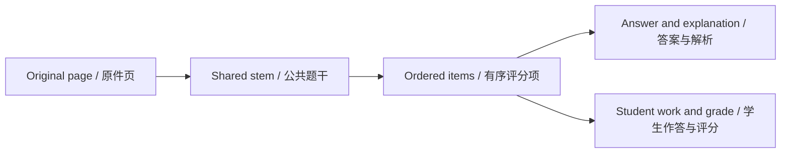

# 参考答案、评分证据与重新识别

[首页](Home-zh-CN.md) · [功能详解](Feature-Guide-zh-CN.md) · [English](Features-References.md)

## 添加文件不等于应用答案

向试卷添加参考页，合计仍不超 12 页。页面只是来源材料；整理参考答案启动独立任务，提取并匹配条目，不自动改变旧评分。

任务后打开整理结果，查看印刷题号、答案、可选解析、匹配或待确认、原页证据。可疑匹配先点来源核对。

## 同时核实内容与题号

不同分区可能都从第一题编号，答案键同号不足以确认。核对学科、题干上下文、小问结构与答案含义。

可保留未匹配并说明原因，不强凑关系。同一题/小问不能匹配多个竞争条目，替换列表需保留已有作答引用的键。

## 有意图地重批

要用于评分，运行整卷重新识别，会产生新供应商调用。先检查手动评分，它们受保护，新答案不是覆盖指令。

优先规则：
- 手动评分保持手动。
- 教师模式保留明确教师评分和证据。
- 其他情况按已核实匹配参考评分。
- 无匹配时以模型解答为依据。

AI 解答与参考冲突时另存差异，不静默替换参考。

## 逐页覆盖

已覆盖表示关联了已存题目键；无法识别表示内容读不清且需原因；无题目也需原因。覆盖不是逐像素完整抄录证明。

跨两页题需核对题目来源页、各评分项配图与证据，文字完整也要检查缺图。

## 安全重复处理

广泛重跑前备份。稳定键支持更新；省略可选值保留旧值，明确空值可替换。已提交结果在后续失败时保留。检查新任务并比较答案、参考、评分、覆盖，不假设后一次必然更好。

实现与参考: [LibraryGrading.cs](../../src/OhMyStudy.Infrastructure/Storage/LibraryGrading.cs) · [MainWindow.Results.cs](../../src/OhMyStudy.App/MainWindow.Results.cs) · [WorkflowPrompts.cs](../../src/OhMyStudy.Infrastructure/Grading/WorkflowPrompts.cs)

---

[上一章](Features-Workspace-Editing-zh-CN.md) · [章节目录](Feature-Guide-zh-CN.md) · [下一章](Features-Tasks-zh-CN.md)
