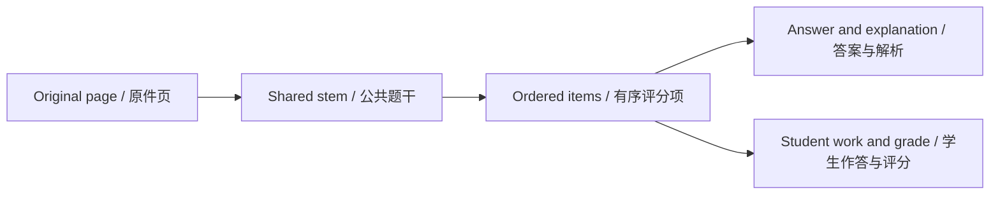

# Reference answers, grading evidence, and re-recognition

[Home](Home.md) · [Feature Guide](Feature-Guide.md) · [简体中文](Features-References-zh-CN.md)

## Adding a file is not applying its answers

Add reference answer pages to the open exam, keeping the combined page count within 12. The pages are source material. Organize reference answers starts a separate reference-only model task that extracts and matches entries. Existing question grades do not automatically change.

After that task, open recognition results. Each entry includes its printed number, answer, optional explanation, match or uncertainty, and original evidence. Use the source link to verify a suspected mismatch.

## Match by content as well as number

Two exam sections can both contain Question 1. The same number in an answer key is insufficient. Check subject, stem context, part structure, and the answer's meaning.

An answer can remain unmatched with a reason rather than forcing a weak association. One question/item cannot have multiple competing matched entries in the saved reference list. A list replacement must retain keys already used by saved attempts.

## Regrade only when you intend to

To use the organized references for grading, run whole-exam Re-recognize. This starts new provider calls. Read existing manual grades first: those are protected, and a new reference is not an instruction to overwrite them.

The priority rules are:
- Existing manual grades remain manual.
- In teacher mode, explicit teacher grades/evidence are preserved.
- Otherwise a verified matched reference is the grading basis.
- Without a match, the model's own solution is the basis.

If the AI solution disagrees with a matched reference, the conflict is stored separately; it is not silently substituted for the reference.

## Read page coverage

Covered means saved question keys were associated with that page. Unreadable means relevant content could not be read and needs a reason. No questions also needs a reason. A coverage entry is not a pixel-level proof of complete transcription.

For a question continued across two pages, check the question source pages and all item diagrams/evidence. Review missing diagrams even if the printed text appears complete.

## Safe repeat processing

Back up before a broad rerun. Stable keys allow updates; omitted optional values keep older values, explicit empty values may replace them. Successfully committed corrections/results remain if later processing fails. Inspect the new task and compare the resulting answers, references, grades, and coverage rather than treating a later run as inherently better.

Implementation and reference: [LibraryGrading.cs](../../src/OhMyStudy.Infrastructure/Storage/LibraryGrading.cs) · [MainWindow.Results.cs](../../src/OhMyStudy.App/MainWindow.Results.cs) · [WorkflowPrompts.cs](../../src/OhMyStudy.Infrastructure/Grading/WorkflowPrompts.cs)

---

[Previous chapter](Features-Workspace-Editing.md) · [Section contents](Feature-Guide.md) · [Next chapter](Features-Tasks.md)
