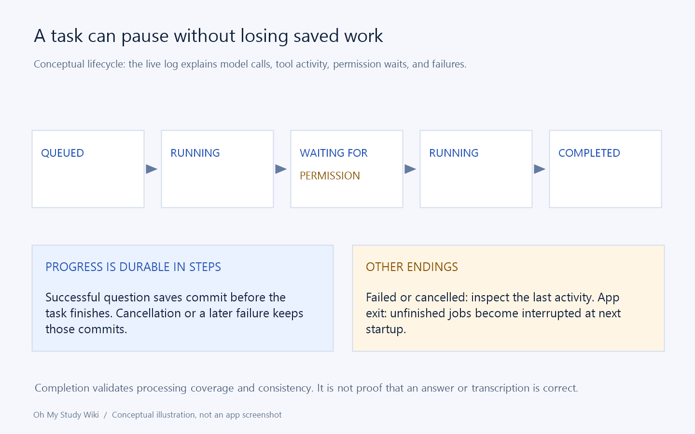

# Troubleshooting, appearance, language, and practical limits

[Home](Home.md) · [Feature Guide](Feature-Guide.md) · [简体中文](Features-Troubleshooting-zh-CN.md)

## Find the failing stage first

Use this order: launch → local import → provider request → tool/save → final coverage → local export. Each stage has different remedies. Reinstalling cannot correct an invalid API key, while repeatedly changing model IDs cannot replace a missing local document component.

| Evidence | Investigate |
| --- | --- |
| App fails before a task starts | Complete package, installation prerequisites, Windows/CPU compatibility. |
| File will not import | Format, encryption/corruption, page/byte/pixel limits. |
| Provider call fails | API type/address, key, ID, quota, network, supported thinking/capabilities. |
| Task waits | Selected task, permission request, current provider activity. |
| Save tool fails | Required fields, source roles/bounds, scores, stable keys/reference consistency. |
| Finish fails | Unread required pages, omitted questions, invalid coverage or reference matches. |
| Export fails | Unsaved edits, handwriting flags, source images, budgets, local tools, destination. |

Start with the displayed error and last activity. Keep originals and saved work while diagnosing. For quality problems, compare the evidence manually rather than interpreting a retry as a guarantee.

## Missing cost is not a free call

Check rates, currency, and reported bucket counts. A provider can omit statistics that the estimator needs. Keep missing distinct from explicit zero and consult the provider's own usage/billing for actual charges.

## Appearance and language

Choose Follow Windows, Light, or Dark under Appearance. Interface language supports Simplified Chinese, English, Japanese, and Korean, with system following. Save work and restart for a language change. Unsupported Windows languages fall back to English; Chinese locales select Simplified Chinese.

This is interface translation. It does not translate original questions, user text, or existing model responses. Generated explanation instructions currently request Simplified Chinese. Japanese/Korean UI support also does not add corresponding print fonts; check output for those scripts.

## Know what a retry preserves

Cancelled, failed, or interrupted tasks keep successful commits. Re-recognition can update non-protected fields. Structured manual grades and explicit teacher results in teacher mode are protected, but a later run is not a full revert mechanism.

## Report a useful issue

Include app version, package variant, Windows version, input type/page count, selected mode/protocol, exact steps, task state, and relevant error. Say whether the issue is reproducible on a small non-private sample. Redact keys, personal information, student handwriting, and private document content from anything posted publicly. Prefer a minimal reproducible example over uploading your full library.

Implementation and reference: [MainWindow.Language.cs](../../src/OhMyStudy.App/MainWindow.Language.cs) · [MainWindow.Tasks.cs](../../src/OhMyStudy.App/MainWindow.Tasks.cs) · [UiText.cs](../../src/OhMyStudy.App/Localization/UiText.cs)

## Files API and recovery diagnostics

A rejection of `purpose=vision` during Responses upload indicates an older build: current inference uploads use `user_data`, as required by DeepSeek. Update the app and retry the failed task. Providers must support image file IDs and the one-hour expiry contract; otherwise disable Support Files API before a new task, accepting inline-image request limits.

Retry task rolls back that run when recovery/edit checks allow it; Re-recognize keeps current results. See [recovery and local log locations](Features-Tasks.md). Failure logs contain detailed context and may include private study text; review before sharing.

---

[Previous chapter](Features-Library.md) · [Section contents](Feature-Guide.md)
