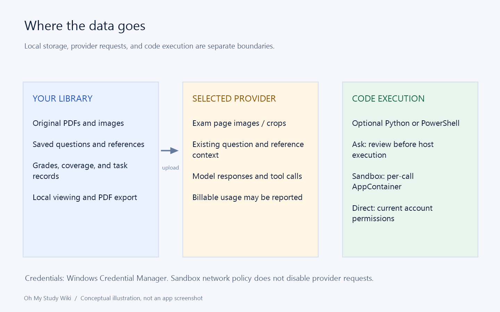

# 1. Install and prepare your first model

[Home](Home.md) · [Quick Start](Quick-Start.md) · [简体中文](Quick-Start-Setup-zh-CN.md)

## What you will have at the end

A running app, a saved provider and model, and an execution policy you understand. You can then import a small exam without guessing which service will receive it.

## Install the complete package

Download from the project's Releases page. For a typical Windows 10/11 x64 computer, choose the `vX-aot` release. Self-contained and framework-dependent builds have different runtime prerequisites; follow the installation guide rather than choosing by file size.

Run `Setup.exe` for a one-click, per-user installation under `%LOCALAPPDATA%/TaiRuiQu.OhMyStudy`. With portable ZIP, extract the entire archive before running `OhMyStudy.App.exe`. Keeping only the EXE discards native document/computation components. Installation and opening saved materials do not require a model request.

At startup, the app centers its window in the current screen's available work area and fits the saved window size within it. A previously maximized window opens maximized.

## Create the connection

1. Open Settings and add a provider.
2. Give it a recognizable name, such as your service's name.
3. Select the API type matching the endpoint: Responses or Messages.
4. Enter the provider's address and your key, then save.
5. Import models, or add the exact model ID manually.
6. Confirm image and tool support and save the model.

A display name is for your convenience; the ID is sent to the service. Do not put the API key in the name or URL. The key belongs in the key field and is stored with Windows credentials.

## Choose how calculation code runs

Before the first task, visit Settings → Execution. The current default runs code directly with your account's permissions. Ask every time lets you inspect requested Python/PowerShell; sandbox mode isolates each call in AppContainer. Provider requests still go online in every mode.

## Check that you are ready

Test connection with the saved model. This is a small potentially billable call, not an exam-accuracy test. If it fails, check protocol, address, key, ID, quota, and network before importing. Start with a clear one- or two-page document so the first result is easy to review.

Implementation and reference: [installation.md](../installation.md) · [MainWindow.Models.cs](../../src/OhMyStudy.App/MainWindow.Models.cs)

---

[Section contents](Quick-Start.md) · [Next chapter](Quick-Start-First-Exam.md)
