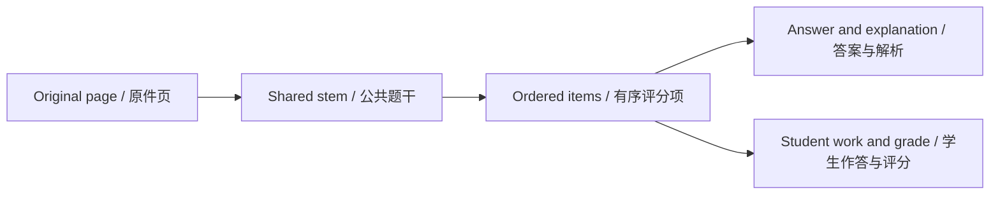

# 3. 核对证据并完成首次修正

[首页](Home-zh-CN.md) · [快速开始](Quick-Start-zh-CN.md) · [English](Quick-Start-Verify.md)

## 对照结构化结果与原页

打开试卷并查看原件，定位原件跳到所选题目的证据。窄窗口下原件可能占用题目区，关闭即可返回。用翻页、缩放查看小字，旋转侧向材料。

检查含义而非仅看版式。缺少负号会改变公式，即使显示很像正确答案。跨页题需检查全部相关页面和小问。

## 固定核对顺序

1. 题号、题干、选项。
2. 公式、表格单元格、图示边界。
3. 学生答案与实际笔迹。
4. 标准答案与解析。
5. 判定、得分/满分、评分来源。
6. 整理结果中的覆盖和答案匹配。

完成任务仍可含无法识别页与待确认内容，需阅读原因，不把完成等同准确。

## 做一次修正

打开编辑题目，展开分区、修改并保存。例如将误识别 x + 1 改为公式块中的 x - 1。若影响答案和解析，也需一并核实；改题干不代表应用自动重算或证明答案。

已有作答须保持分数与判定一致。四分题部分正确可为两分，部分正确却给四分则不一致。未知分数留空。

## 理解保护边界

结构化编辑器仅在校验成功时保存草稿，并把该题各评分项内的作答评分标为手动，后续 AI 会保留。非评分文字仍可能在重识别时更新，这不是通用撤销历史。

待确认本身不触发错题收录，应单独核对，证据充分后再改判定。

实现与参考: [MainWindow.Editing.cs](../../src/OhMyStudy.App/MainWindow.Editing.cs) · [MainWindow.Results.cs](../../src/OhMyStudy.App/MainWindow.Results.cs)

---

[上一章](Quick-Start-First-Exam-zh-CN.md) · [章节目录](Quick-Start-zh-CN.md) · [下一章](Quick-Start-Review-Export-zh-CN.md)
