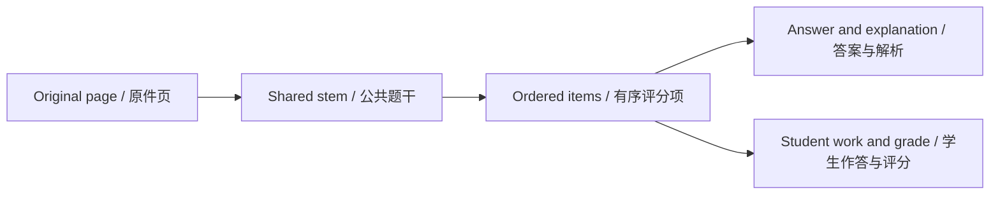

# 3. Verify evidence and make your first correction

[Home](Home.md) · [Quick Start](Quick-Start.md) · [简体中文](Quick-Start-Verify-zh-CN.md)

## Compare the structured result with the page

Open the exam and choose View original. Locate in original jumps to the selected question's evidence. On narrow windows the original can occupy the question area; close it to return. Use page navigation and zoom for small print, and rotation for sideways material.

Check meaning, not only appearance. A missing minus sign changes a formula even if the layout looks convincing. For continued questions, verify all relevant pages and parts.

Recognition stores Arabic-digit question numbers as plain digits, such as `1`, `2`, and `3`, and subquestion labels as `(1)`, `(2)`, without trailing periods. The question list also hides a trailing period on existing numeric labels; saved source identifiers, including Roman numerals, remain unchanged.

## A repeatable review order

1. Confirm the question number, stem, and options.
2. Check formulas, table cells, and diagram boundaries.
3. Compare the student answer with the actual handwriting.
4. Check the standard answer and explanation.
5. Inspect verdict, earned/possible points, and grading source.
6. Open recognition results for page coverage and reference matches.

A completed task can still contain unreadable pages or uncertain content. Read those reasons instead of assuming completion means accuracy.

Once you have checked a transcription concern against the original, click **Confirm result** in its Needs review notice. This clears the review text without changing content or grades. An uncertain grade still requires a supported grading correction and can keep the question in Needs review.

To add work to a blank exam, use **Enter student answer** on the question page or **More → Upload student answers** in the exam, then **Recognize again**. Save entered work separately from standard answers; editing it clears its previous result. See [student work and review](Features-Workspace-Editing.md#add-student-work-and-confirm-reviewed-results).

## Make one correction

Select Edit question, expand the section, change the value, and save. For example, correct a recognized formula from x + 1 to x - 1 in its formula block. Correct an associated answer/explanation if the sign change affects it; editing a stem does not independently prove or recalculate its answer.

For an answered question, keep score and verdict consistent. If a four-point question is partially correct, a score such as two is consistent; four points with a partial verdict is not. Leave unknown scores blank rather than guessing.

## Understand the protection boundary

The structured editor saves a local draft only when validation succeeds and marks attempt grades in that question manual. Later AI runs preserve those manual grades. Non-grade text can still change during re-recognition; this is not a general undo history.

Uncertain questions do not enter Mistakes solely because they are uncertain. Review them separately and correct the verdict only when the evidence supports it.

Implementation and reference: [MainWindow.Editing.cs](../../src/OhMyStudy.App/MainWindow.Editing.cs) · [MainWindow.Results.cs](../../src/OhMyStudy.App/MainWindow.Results.cs)

---

[Previous chapter](Quick-Start-First-Exam.md) · [Section contents](Quick-Start.md) · [Next chapter](Quick-Start-Review-Export.md)
