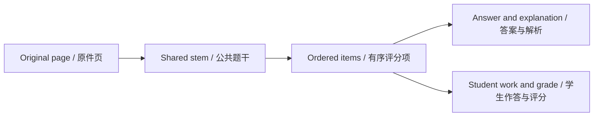

# 文档准备、页面身份与坐标变换

[首页](Home-zh-CN.md) · [技术内幕](Tech-for-nerds-zh-CN.md) · [English](Tech-Document-Pipeline.md)

## 分离原件与显示

资源记录 MIME、大小、尺寸、文件名；SourcePage 记录文档、顺序、角色、旋转、预览状态、可选原资源/PDF 索引。渲染 PNG 可用于识别，PDF 仍留作证据。

媒体在数据库线程外解码/缩略，PDFium 栅格化。输入与派生资源受限制，压缩 PDF 小不代表处理便宜。

## 稳定身份

页 ID 不等于显示页码。PageIndex 决定顺序，PDF 索引定位原 PDF，区域引用 ID，因此排序不使所有题目指错页。

材料、参考答案、补充学生作答分别使用 `material`、`reference`、`student` 角色。题目来源与内容图片须用材料页；学生作答与教师批注可引用材料页或作答页；参考答案须用参考页，保存前校验角色。三类页面共享每份试卷 12 页限制。

## 单一坐标约定

区域相对未旋转完整页：

    左 = x × W
    上 = y × H
    像素宽 = width × W
    像素高 = height × H

W=1000、H=2000 时 (0.1,0.2,0.3,0.1) 为 (100,400,300,200)。显示旋转 90 度只改呈现变换，不改存储坐标。上图为概念图，区域不按该数值比例绘制。

read_pages 按序回传每页结果、裁片、旋转、尺寸、坐标系和本地图片路径。模型区域用 0–999 整数 bbox 四角，存储区域使用上述归一化矩形。裁片用于看细节，不能把裁片像素当原页坐标。

## 阅读性能

`NativePageImages` 分离模型传输与显示/导出读取。模型页面、裁片和生成图片预览以 base64 编码前 200 KiB 为目标，小图保留无损 PNG，大图使用有质量和尺寸下限的彩色 JPEG，达到下限时仍可能超出目标。原始资源及显示/导出读取不被模型压缩字节替换。

有界缓存控制保留的栅格资源。阅读服务结合取消/代际处理避免旧工作覆盖新选文档。淘汰缓存影响速度/内存，不改持久原件。

## 删除与失败边界

界面枚举题干、图片、作答、教师、小问、参考等页引用，仓储也校验更新。不是当前题可见来源也可能仍是证据，不能随意删。

准备失败查格式、完整性、限制、原生组件。原件已存后模型失败应在任务阶段恢复，不静默丢源。

源码: [NativeMediaProcessor.cs](../../src/OhMyStudy.App/Services/NativeMediaProcessor.cs) · [LibraryAssets.cs](../../src/OhMyStudy.Infrastructure/Storage/LibraryAssets.cs) · [PageViewportTransform.cs](../../src/OhMyStudy.Documents/PageViewportTransform.cs) · [BoundedPageCache.cs](../../src/OhMyStudy.Documents/BoundedPageCache.cs)

---

[上一章](Tech-Architecture-zh-CN.md) · [章节目录](Tech-for-nerds-zh-CN.md) · [下一章](Tech-Model-Loop-zh-CN.md)
