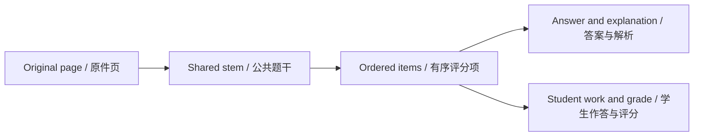

# Document preparation, page identity, and coordinate transforms

[Home](Home.md) · [Tech for nerds](Tech-for-nerds.md) · [简体中文](Tech-Document-Pipeline-zh-CN.md)

## Keep original evidence separate from presentation

The library asset model records MIME type, byte size, dimensions, and managed filenames. SourcePage records document membership, order, role, rotation, preview state, and optional original asset/PDF index. That distinction lets a rendered PNG serve recognition while the original PDF remains recoverable evidence.

The media processor prepares decoded images and thumbnails outside the database worker. PDFium supplies PDF rasterization. Limits are applied before/while accepting sources and derived media, so a compressed PDF cannot be assumed cheap merely because its original bytes are small.

## Stable identity survives page rearrangement

A page ID is not its current displayed number. PageIndex controls ordering; PDF page index locates the source within the original PDF. Regions refer to page IDs. Reordering changes presentation without making every question point to a different physical page.

Material, reference, and supplementary student-answer pages have explicit roles (`material`, `reference`, and `student`). Question sources and content images require material pages; student responses and teacher annotations can cite material or student pages; reference answers require reference pages. The validator checks these roles before saving. All three roles share the 12-page exam limit.

## One coordinate convention

Regions store normalized rectangles on the unrotated full page. Given original width W and height H:

    left = x × W
    top = y × H
    width_pixels = width × W
    height_pixels = height × H

For W=1000 and H=2000, (0.1,0.2,0.3,0.1) means (100,400,300,200). A 90-degree display rotation changes the presentation transform; it does not rewrite x/y into a different coordinate system. The image above is schematic, not a scale drawing of that rectangle.

The read_pages response supplies ordered per-page results, crop, rotation, dimensions, coordinate-system labels, and local image paths. Model regions use integer bbox corners from 0 to 999; stored regions use the fractional rectangles above. A crop helps inspect detail, but returned crop pixels must not be mistaken for full-page coordinates.

## Reading performance without changing evidence

`NativePageImages` separates model transfers from display/export reads. Model pages, crops, and generated-image previews target 200 KiB before base64 encoding, using lossless PNG when small or color JPEG with quality and size floors. Reaching those floors can leave images above the target. Original assets and display/export reads are not replaced by the model-compressed bytes.

Bounded page caching limits retained raster work. Reading services select/refresh presentation resources while cancellation/generation handling prevents stale work from replacing a newly selected document. Cache eviction affects speed and memory, not the durable original.

## Removal and failure boundaries

The UI enumerates page references through stems, image blocks, attempts, teacher marks, items, and references before allowing removal. The repository also validates page updates. A page that is still evidence should not be removable just because it is not the current visible question.

If preparation fails, diagnose input format, integrity, limits, or missing native components. If the original was already preserved but a later model job fails, recover at the task stage rather than silently discarding the source.

Source: [NativeMediaProcessor.cs](../../src/OhMyStudy.App/Services/NativeMediaProcessor.cs) · [LibraryAssets.cs](../../src/OhMyStudy.Infrastructure/Storage/LibraryAssets.cs) · [PageViewportTransform.cs](../../src/OhMyStudy.Documents/PageViewportTransform.cs) · [BoundedPageCache.cs](../../src/OhMyStudy.Documents/BoundedPageCache.cs)

---

[Previous chapter](Tech-Architecture.md) · [Section contents](Tech-for-nerds.md) · [Next chapter](Tech-Model-Loop.md)
