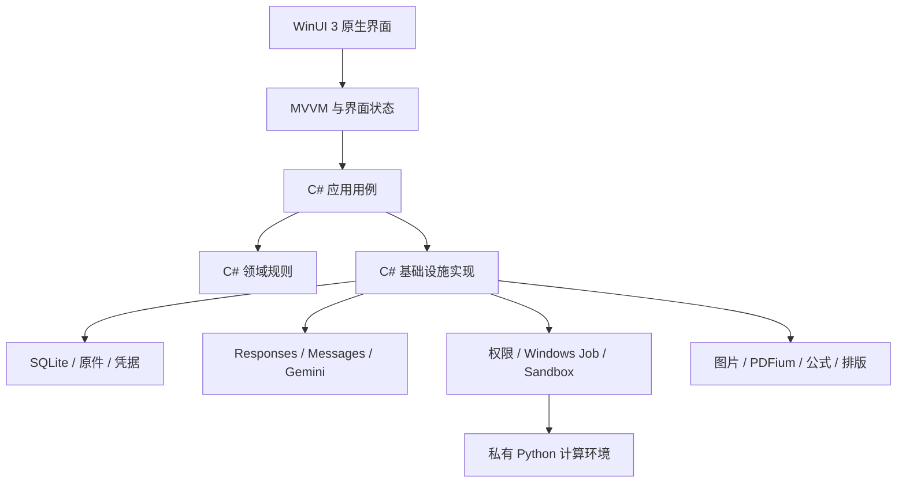

# Oh My Study 原生应用迁移计划

日期：2026-10-18（Asia/Shanghai）
状态：P0完成，P2–P7核心C#实现已通过本机Native AOT合成回归，P8/P9已进入体验初测与离线候选包验证。P1系统矩阵以及Sandbox、真实语义、实际打印、性能和发布验收仍未关闭；准确证据与接续步骤见 [migration-progress.md](migration-progress.md)。勾选表示对应实现或指定本机检查已交付，不代表外部验收通过。

## 1. 已确认的迁移决策

将当前 Tauri 2 / React / TypeScript / Rust 应用重建为 **C# + WinUI 3 + Fluent Design 2** 原生 Windows 应用，使用 **Native AOT** 发布。

用户已明确：**业务后端也等价重写为 C#，保留业务规则和数据兼容。** 现有 Rust 业务实现用于迁移期间的行为对照，最终不作为新客户端的业务后端或常驻辅助服务。

2026-10-18追加的仓库架构决定：**旧代码全部放入Git忽略的`.reference/`，正式仓库直接呈现标准C#工程**。根目录采用解决方案、`src/`、`tests/`与集中工具链配置；新构建、测试和发布不依赖`.reference/`。该整理不等于业务或数据切换已经完成。原迁移起点与历史版本可由Git提交恢复。

迁移目标：

- 仅面向 Windows 10 / 11 x64，不投入 macOS、Linux 或跨平台界面适配。
- 应用界面、预览、导出及打印路径均不依赖 WebView2、Edge、Chromium 或其他浏览器。
- 业务、数据、网络、任务与 Windows 能力编排统一使用 C#。
- 保留现有业务规则、资料、原件、题目、任务记录与凭据引用的兼容性。
- 以原生交互、稳定帧时间、及时输入反馈、可靠取消和合理资源使用作为验收目标。
- 使用完整离线安装包，普通用户无需安装开发 SDK、系统 Node.js、Python 或完整 TeX。

PDFium、SQLite、Typst 等第三方原生引擎，以及按任务启动的私有 Python 计算环境，可以继续作为依赖使用。其职责、版本、许可证、调用边界和资源占用必须明确，业务编排归属 C#。

本文记录新的技术迁移决定。与旧文档中 React / Tauri / Rust 主体架构、未来跨平台规划冲突的部分，以本文为迁移依据；原有业务规则继续有效。正式实施时同步修订相关文档，不能只修改技术栈名称。

## 2. 当前项目基线

依据旧版 [progress.md](.reference/progress.md)、[历史架构](.reference/docs/architecture.zh-CN.md)及固定迁移起点源码（本地归档于`.reference/`；记录见[P0基线](docs/migration/p0-baseline.zh-CN.md)）：

| 范围 | 当前状态 | 迁移处理 |
| --- | --- | --- |
| M1 应用基础 | 已实现，并有本机桌面冒烟证据 | 等价迁移存储、设置、任务、权限与材料管理 |
| M2 整卷闭环 | 代码和本地验证已接通，真实样卷语义验收未完成 | 迁移批改流程，分别补齐协议与真实语义证据 |
| M0 Windows Sandbox | 原型存在，真实自动生命周期与会话归属未完成验收 | 保留真实能力状态，单列实机验证 |
| 公式预览 | React 中使用 MathJax、mhchem、SVG 和 DOM 处理 | 先验证无浏览器渲染路线 |
| 正式排版 | MathJax → SVG → Typst 的开发探针已验证，包含 Node / Edge | 保留排版语义与样本，重建产品运行链路 |
| M3 题库与错题 | 基本共享视图，完整标签、筛选等未完成 | 迁移已实现行为，剩余功能保留独立待办 |
| M4 复习卷 | 尚未正式实现 | 验证原生排版基础，不将探针视为功能完成 |
| M5 发布完善 | 手机传图、完整离线发布等尚未完成 | 新客户端发布必需项纳入迁移，其余另列后续计划 |

已有测试、开发探针、本机冒烟和真实用户场景的证据层级需要保留。合成协议测试通过不等于真实模型语义正确；程序能启动不等于系统兼容矩阵通过。

## 3. 目标架构

| 层次 | 责任与方向 |
| --- | --- |
| App | WinUI 3、XAML、窗口、导航、原生控件、主题、辅助功能 |
| Presentation | MVVM、界面状态、命令、编译绑定、局部增量更新 |
| Domain | 纯 C# 领域模型、评分约束、来源、题目与任务规则 |
| Application | 导入、批改、编辑、保存、权限处理等用例编排 |
| Infrastructure | SQLite、凭据、文件、网络协议、进程与 Sandbox 实现 |
| Documents | 图片处理、PDFium、公式、字体、原生预览与排版服务 |
| Runtime | 私有 Python 与必要原生组件，按需启动和释放 |



按用户追加决定，根目录直接作为C#工程，通过阶段验收逐步完成业务迁移：

```text
./
  OhMyStudy.slnx
  global.json
  Directory.Build.props
  Directory.Packages.props
  src/
    OhMyStudy.App/
    OhMyStudy.Domain/
    OhMyStudy.Application/
    OhMyStudy.Infrastructure/
    OhMyStudy.Documents/
  tests/
    OhMyStudy.Domain.Tests/
    OhMyStudy.IntegrationTests/
    OhMyStudy.DesktopTests/
  packaging/
  probes/
  .reference/  # 旧工程的本地对照副本，Git忽略、构建隔离
```

项目拆分以职责和可验证性为准，不为未来跨平台增加抽象。旧Rust工程及测试在`.reference/`本地保留，作为行为对照；不再纳入正式源码树、构建图或发布物。固定Git起点和已复制的语言无关兼容夹具共同支撑回退与重现。

### 3.1 工具链与 AOT 约束

- 以 .NET 10 LTS 为工程基线，在 P1 锁定 Windows App SDK、C#/WinRT、MVVM 工具和全部依赖的实际版本。
- 启用 AOT 与裁剪分析，持续发布并运行 Release Native AOT 产物。
- JSON 优先使用 `System.Text.Json` 源生成；界面优先使用编译绑定与源生成命令。
- 避免依赖运行时代码生成、动态程序集加载或未经验证的反射扫描注册。
- Windows 互操作按实际 API 选择源生成 P/Invoke、C#/WinRT 或其他经过 AOT 验证的实现。
- 自有代码不得遗留未解释的 AOT / 裁剪警告；第三方警告逐项记录和验证，不通过全局屏蔽消除。
- 每个阶段的核心场景都需要运行实际发布产物，Debug / JIT 模式通过不能替代 AOT 验收。

Native AOT 是工程与发布约束。流畅体验还取决于 UI 线程、内存分配、解码、布局、渲染与状态更新，需要分别测量。

## 4. 业务与数据兼容契约

### 4.1 业务行为

迁移时固定并验证以下规则：

- 仅提供整卷入口；不按单题创建 Agent。
- 保留已有教师批改、待 AI 批改、空白试卷三种导入模式。
- 保留教师评分、参考答案、AI 判断之间的优先级与冲突展示规则。
- 保留空白卷与已作答材料中未作答题目的区别，以及部分正确计入错题的规则。
- 保留自动入库、独立重复导入、手动编辑与评分保护。
- 保留一次一个 AI 任务、其余排队；最小化继续运行，退出停止的行为。
- 保留请求权限、Sandbox、绕过权限三种模式，准确显示实际执行环境。
- 保留取消或失败后已成功保存的结果，阻止迟到结果继续提交。
- 保留 Responses / Messages / Gemini 的原生协议和各自思考配置语义。

### 4.2 数据与文件

- 兼容旧`src-tauri/migrations/001_initial.sql`与`002_grading.sql`对应的数据库；正式测试使用独立保存在`tests/Fixtures/LegacyDatabase/`的原字节副本，不引用`.reference/`构建输入。
- 保留资料、原件、题目、供应商、任务及事件的标识、关联关系和排序。
- 按现有模型分别保留 JSON 字段名、枚举判别、空值、时间、数值及未知字段处理规则。
- 保留原件字节、资产路径语义、PDF 原页引用和题目来源坐标；预览缓存允许重建。
- 保留 `OhMyStudy/provider/` 凭据目标命名与数据库中的引用关系，在目标部署身份下验证可访问性。
- 明确解析旧版实际资料目录，避免新安装身份或默认目录变化导致资料被误判为空。
- 建立资料库单写入者保护，避免旧版和新版同时写同一份数据。
- 升级前使用一致性备份；不能在数据库活动时仅复制主文件而忽略 WAL。
- 架构变更、数据升级和回退兼容性分别记录；不得将新版本写入后的资料默认视为旧版可读。

开发及自动验收使用合成资料和隔离资料库。真实资料迁移在备份、版本检查与恢复路径验证后进行。

## 5. 分阶段执行计划

以下保留分阶段门槛，并按当前交付更新清单。每阶段交付物应记录工具版本、运行环境、验证方法、结果和未通过项；尚未勾选的混合条目可能已实现部分代码，需查进度中的准确边界。

### P0：建立行为基线与迁移边界

任务：

- [x] 固定迁移起点提交和可运行旧版，记录现有环境与依赖来源。
- [x] 盘点现有命令边界、领域模型、数据库、资产、协议、任务和权限实现。
- [x] 整理已有 Rust 测试、协议夹具、SQL、排版样本与桌面冒烟场景。
- [x] 建立跨语言行为对照，标明确定行为、尚未验收行为及已知问题。
- [x] 建立性能测量方法与代表性材料规模，不将开发探针数字当作产品基线。
- [x] 确定项目兼容矩阵、资料目录策略及迁移回退条件。

交付：行为与数据兼容清单、回归样本、旧版对照构建及迁移起点记录。

通过条件：每项已实现核心行为都有来源与验证方法；未完成项有独立状态，没有被归入已通过基线。

### P1：验证 Native AOT 与无浏览器技术路线

任务：

- [x] 创建最小 WinUI 3 工程并锁定工具链，发布 Release Native AOT 程序。
- [ ] 验证绑定、命令、主题、窗口、文件选择、拖放、凭据、SQLite 与 PDFium。
- [ ] 验证打印相关互操作、发布身份与原生依赖加载。
- [ ] 在干净 Windows 10 / 11 系统运行发布产物，记录技术下限和实测范围。
- [x] 制作原件与题目对照工作区，包含大图浏览、来源高亮、虚拟化列表和任务更新。
- [ ] 验证数学、中文与 mhchem 化学式的无浏览器公式路线。
- [ ] 验证公式图形、固定字体、排版引擎、PDF 预览与导出的完整样本链路。

公式样本至少覆盖分式、矩阵、上下标、求和、中文条件、离子电荷、化学反应箭头、长公式和非法输入。不能将仅支持基础数学的候选库视为完整替代品。

交付：AOT 试验构建、原生工作区样板、依赖兼容表、公式与 PDF 验证记录、锁定版本清单。

通过条件：关键 API 和依赖在实际 AOT 产物中工作；无浏览器公式路径达到必要语义覆盖；参考界面达到可继续扩展的视觉与交互品质。

关键技术风险未通过时，在本阶段调整依赖或实现路线，不进入大规模业务迁移，也不默认改为 JIT 发布或浏览器渲染。

### P2：建立工程底座和领域模型

任务：

- [x] 建立分层解决方案、集中依赖管理、统一错误与取消约定。
- [x] 迁移领域模型、题目结构、来源、评分和配置约束。
- [x] 建立符合旧格式的 JSON 源生成上下文与兼容性测试。
- [x] 实现界面状态、命令、局部通知和 UI 线程调度规则。
- [x] 建立不记录密钥及完整敏感响应的结构化诊断方式。
- [x] 将格式检查、核心回归和 AOT 发布检查纳入构建流程。

交付：可持续构建的 C# 底座、领域模型及兼容性回归。

通过条件：领域规则与序列化契约通过行为对照；依赖方向清晰；实际发布产物可运行。

### P3：迁移存储、资产与凭据

任务：

- [x] 迁移 SQLite 版本识别、迁移、事务、WAL、外键和参数化查询。
- [x] 实现有序写入与受限后台工作，拆开数据库操作和重型媒体处理。
- [x] 迁移材料、页序、旋转、参考答案、题目、任务及事件持久化。
- [x] 保留原件、缩略图、安全资产标识、路径校验和图片输入限制。
- [x] 实现 Windows 凭据管理，验证引用复用、替换失败和删除行为。
- [x] 实现一致性备份、迁移恢复和资料库单写入者保护。

交付：C# 持久化实现、旧资料库兼容报告及失败恢复验证。

通过条件：旧数据可读取和编辑；原件保持完整；事务或文件操作失败时不会留下半完成状态；数据库及解码工作不阻塞 UI。

### P4：迁移任务、权限与执行器

任务：

- [x] 使用类型明确的任务队列、状态机及贯穿调用链的取消信号。
- [x] 迁移单任务运行、排队、权限等待、重启中断及任务事件顺序。
- [x] 保持任务快照与事件提交的一致性，阻止取消后的迟到保存。
- [x] 迁移逐次批准、本任务批准与拒绝，批准继续绑定具体调用内容。
- [x] 实现 Windows Job Object 执行器，覆盖挂起创建、绑定、启动和进程树回收。
- [x] 验证超时、输出上限、中文路径、参数传递、环境白名单及正常退出。
- [x] 单独实现 Sandbox 能力状态、会话归属、桥接及生命周期，并通过隔离回归；实机按用户要求交接。

交付：C# 任务系统、宿主执行器、权限回归及独立的 Sandbox 实机记录。

通过条件：取消、退出和错误回收可靠；未批准调用不执行；Sandbox 失败不在宿主重放；不接管或关闭用户已有沙箱，不自动启用系统功能或提权。

### P5：迁移模型协议与整卷批改

任务：

- [x] 等价迁移 Responses、Messages、Gemini 请求、响应及模型列表。
- [x] 验证 SSE 分块、Unicode 边界、图片、工具循环、思考上下文及签名保留。
- [x] 迁移用量、价格估算、未知能力、错误分类、重试边界与网络取消。
- [x] 迁移三种导入模式的整卷流程、参考答案匹配、覆盖及评分校验。
- [x] 迁移自动保存、幂等、手动编辑保护与来源追溯。
- [x] 使用本地合成 HTTP 服务进行行为对照；真实供应商与样卷验收按用户要求交接。

交付：三协议 C# 实现、整卷用例及协议与语义分开的验收记录。

通过条件：合成和环回回归通过；真实语义仍需按数学多栏、生物续题、化学教师批改等代表性材料检查漏题、串答和评分差异。

### P6：完成原生文档与公式管线

任务：

- [x] 实现按需解码、分辨率分级缓存、受限预取和缓存回收。
- [x] 保持 PNG / JPEG / WebP 与 PDF 输入能力，不因渲染方案变化丢失格式支持。
- [x] 实现缩放、平移、旋转和来源区域定位，验证全部坐标变换。
- [x] 使用原生控件呈现题目正文、选项、表格和图像。
- [x] 集成 P1 通过的无浏览器公式引擎，保留 LaTeX / 化学语义及可读回退。
- [x] 统一预览与导出的字体、公式图形、尺寸和基线规则。
- [x] 保留固定模板与题答隔离，验证 A3 / A4 样本、分页及字体嵌入；实际打印按用户要求交接。

交付：原生材料阅读器、公式显示组件及无浏览器排版基础。

通过条件：12 页材料浏览稳定；来源高亮准确；公式与化学样本可读；预览、导出、打印不启动浏览器。排版基础通过不等于 M4 复习卷功能完成。

### P7：完成原生应用与核心工作流

任务：

- [x] 完成应用窗口、原生导航、材料导入、最近材料和原件对照工作区。
- [x] 迁移批改结果、题目编辑、基础题库与错题、模型设置及任务交互。
- [x] 使用原生菜单、对话框、文件选择与输入控件。
- [x] 按局部状态增量更新，避免任务事件触发全工作区重建。
- [x] 恢复页面选择、焦点、滚动与缩放状态，处理异步返回与导航竞争。
- [x] 重写产品文案，移除 M1 / M2 阶段标签、开发说明与无效占位入口。

交付：覆盖当前已实现核心流程的原生客户端。

通过条件：核心流程均可独立完成；重复点击、切换、返回和在途取消行为稳定；功能结果与兼容基准一致。

### P8：集中打磨体验与性能

本阶段集中验收第 6、7 节标准，相关约束从 P1 起贯穿开发。

任务：

- [x] 统一主题资源、字号、间距、图标、表面、边界和信息层级。
- [x] 补齐原生控件/焦点/键盘/高对比资源；实体输入法与读屏验收按用户要求交接。
- [x] 调校滚动、缩放和连续操作，使用系统控件动画及即时视口恢复；系统动画开关实测交接。
- [x] 加入实际AOT性能采样，记录UI分发、Rendering回调、分配/GC、解码/缓存与内存原始数据；GPU/ETW与参考机预算交接。
- [x] 完成本机窗口/主题/连续使用自动验证；高DPI、跨屏及长时人工验收按用户要求交接。

交付：体验验收记录、性能原始数据、问题修正及剩余限制。

通过条件：代表性界面达到统一交互标准；参考设备满足已固定的性能预算；所有保留问题明确记录。

### P9：离线发布、数据切换与旧工程退役

任务：

- [x] 验证 Native AOT 与 Windows App SDK 自包含部署的完整组合。
- [x] 打包原生库、运行时、字体、资源、许可证及可重建的版本清单。
- [ ] 在无开发环境的干净系统进行离线安装、运行、升级、卸载与恢复验证。
- [ ] 检查预览、导出和打印的实际进程与依赖，确认不存在浏览器运行路径。
- [ ] 在一致性备份后切换资料，验证旧凭据、原件、题目及任务记录。
- [ ] 完成回退验证，再退役旧 Web / Tauri / Rust 业务工程。
- [x] 更新 README、架构、需求、实施计划、进度与构建验收脚本。

交付：原生离线安装包、迁移与恢复说明、兼容矩阵和发布验收报告。

通过条件：干净 Windows 10 / 11 可离线安装和完成本地核心操作；用户资料连续可用；已实现业务全部迁移；遗留产品功能保持独立状态。

## 6. 原生体验验收标准

| 维度 | 要求 |
| --- | --- |
| 视觉 | 统一字号、间距、图标与层级；使用主题资源；中文与数学混排稳定 |
| 控件状态 | 覆盖默认、悬停、按下、焦点、选中、禁用、加载与错误状态 |
| 动效 | 有明确交互目的，可中断、可连续操作；遵循系统设置，避免每帧触发重型布局 |
| 阅读 | 大图与题目联动准确；缩放、平移、返回和切页保持上下文 |
| 输入 | 中文输入法组合文本稳定；选择、剪贴板、撤销及快捷键符合控件语义 |
| 键盘与焦点 | 支持完整键盘导航；对话框关闭后恢复焦点；弹出层退出行为一致 |
| 辅助功能 | 名称、状态与读屏顺序正确；自定义区域提供必要的自动化语义；不只靠颜色区分评分 |
| 反馈 | 操作及时给出真实状态；错误提供可执行的恢复动作；进度与完成状态有实际依据 |
| 窗口与 DPI | 系统标题栏操作、贴靠、最大化、多显示器及跨屏缩放可靠 |
| 系统适配 | 浅色、深色、高对比度、强调色与减少动画均有明确效果 |
| 材质回退 | Windows 11 材质与 Windows 10 回退表面分别设计，并覆盖透明效果关闭等情况 |

原生标准控件作为主要交互基础。复杂原件视口等确有需要的区域才采用自定义绘制，并同时验收输入、辅助功能和资源释放。

## 7. 性能预算与测量口径

以下为待验证的初始预算，不是已测结果。P1 固定参考 CPU、GPU、8 GB 内存、SSD、系统版本、显示刷新率与测量方法；后续如需调整，必须记录依据。

| 项目 | 初始目标 |
| --- | --- |
| 启动至可操作 | SSD 参考机 P95 ≤ 1.5 秒，分别记录冷启动与热启动 |
| 普通操作视觉反馈 | ≤ 50 毫秒，不包含在线模型完成时间 |
| 已缓存页面返回 | P95 ≤ 100 毫秒，并保持选择、焦点及视口 |
| 滚动与缩放 | 60 Hz 场景按 16.7 毫秒帧预算验收，报告 P95 / P99 和掉帧情况 |
| 高刷新率场景 | 在对应设备上以 120 Hz / 8.3 毫秒预算专项验证 |
| 空闲私有内存 | 目标 ≤ 150 MiB，首轮验收门槛 ≤ 200 MiB |
| 常规本机任务峰值 | 保留现有约 1 GiB 的全进程目标，包含本机 Python 与辅助进程 |
| 长时间使用 | 重复浏览、编辑、任务取消和排版后，资源可回收并趋于稳定 |

测量要求：

- 使用 Release Native AOT 产物，保留原始数据及场景说明。
- 统计同一时刻的应用与所属辅助进程私有字节，工作集和 GPU 内存另行记录。
- Sandbox 虚拟机及系统开销独立测量，不能忽略后宣称满足本机任务的总峰值目标。
- 使用代表性 12 页高分辨率材料、较大题库、连续任务及取消场景，不能只测空窗口。
- 记录 CPU、UI 线程、解码、布局、渲染、分配与 GC 信息，按证据定位问题。
- 持续采样可能遗漏瞬时峰值，需要说明采样间隔、缺失指标与结果边界。

## 8. Windows 兼容与发布矩阵

建议至少覆盖以下实机或虚拟机环境：

| 维度 | 验证范围 |
| --- | --- |
| Windows 10 | 22H2 x64、LTSC 2021 x64 分别验证 |
| Windows 11 | 24H2 / 25H2 x64，记录具体构建号与版本 |
| 缩放 | 100%、125%、150%、175%、200%，包含跨显示器移动 |
| 显示与输入 | 常见笔记本分辨率、60 Hz、高刷新率设备、鼠标、触控板与键盘 |
| 系统设置 | 浅色 / 深色、高对比度、透明效果与动画开关 |
| 能力差异 | Sandbox 可用、未就绪、不支持、被占用；打印机不可用等状态 |
| 干净系统 | 无开发 SDK、无系统 Node.js / Python / TeX；本地功能离线运行 |
| 资料与路径 | 旧资料库、中文及空格路径、只读位置、磁盘不足及恢复场景 |

Windows App SDK 的技术最低版本、.NET 的官方维护支持范围和项目实际兼容矩阵需要分别记录。P1 确认最终系统下限；不能仅通过设置目标框架就承诺所有 Windows 10 历史版本可用。

原生依赖、自包含运行时和安装身份需要整体验证。优先评估适合离线分发及当前本地能力的安装方式；若采用 MSIX，需要再次检查资料路径、凭据可访问性、外部进程及 Sandbox 行为。

## 9. 主要风险与阶段门槛

| 风险 | 处理方式 | 关闭门槛 |
| --- | --- | --- |
| 依赖在 JIT 下可用、AOT 下失败 | 在最小探针中发布并实际运行，审查源生成和裁剪需求 | P1 / 各阶段持续发布 |
| 无浏览器公式引擎缺少 mhchem 或中文能力 | 使用固定数学与化学样本比较语义、尺寸、基线及错误处理 | P1 选型，P6 集成 |
| 旧数据库可打开但 JSON 语义变化 | 比较记录及领域结果，覆盖枚举、空值、时间与边界输入 | P2 / P3 |
| 安装身份变化导致资料或凭据不可见 | 明确旧目录解析，验证实际发布身份与完整升级路径 | P1 / P3 / P9 |
| 任务取消后仍写入或残留子进程 | 验证提交屏障、调用取消及所属进程树回收 | P4 / P5 |
| Sandbox 原型被误认为已完成能力 | 独立记录系统检测、归属、生命周期与真实执行证据 | P4 / 兼容矩阵 |
| Native AOT 已启用但界面仍卡顿 | 跟踪 UI、解码、布局、更新与渲染，逐项消除阻塞 | P1 / P8 |
| 产品运行路径仍隐含调用浏览器 | 检查预览、公式、导出、打印的实际依赖与进程 | P6 / P9 |
| 迁移范围持续扩张 | 现有行为、新发布必需项和未实现产品功能分别跟踪 | 全阶段 |

## 10. 验证与迁移完成定义

| 层级 | 验证内容 |
| --- | --- |
| 领域回归 | 评分、来源、模式、手动保护、取消后的保存规则 |
| 数据兼容 | 旧版本迁移、JSON、资产、事务、备份与恢复 |
| 协议回归 | 三套协议的正常、流式、工具、思考、用量、错误和取消 |
| 执行集成 | 权限批准、宿主进程树、私有 Python、Sandbox 实机 |
| 桌面验收 | 实际 AOT 程序、核心工作流、焦点、DPI、键盘与读屏 |
| 排版验收 | 公式、中文、化学、A3 / A4、题答隔离、预览与纸张打印 |
| 真实语义 | 真实供应商与授权样卷，检查漏题、串答及评分差异 |
| 发布验收 | 干净系统、离线依赖、安装、升级、资料连续性与失败恢复 |

迁移完成必须同时满足：

- [ ] 已实现核心业务均由 C# 承担，回归行为一致。
- [ ] WinUI 原生工作流可独立使用，实际发布产物采用 Native AOT。
- [ ] 应用界面、预览、公式、导出与打印不依赖浏览器。
- [ ] 原资料、原件、关联关系及凭据引用连续可用，迁移与恢复有证据。
- [ ] 必要的 Windows 10 / 11、DPI、辅助功能和性能场景通过。
- [ ] 离线安装包在干净系统验证通过。
- [ ] 真实模型、真实样卷、Sandbox 与实际打印的通过或未通过状态明确，未通过项不能记为验收完成。
- [ ] 新技术架构、构建命令、依赖、测试和进度文档与交付一致。

## 11. 第一批交付与后续产品边界

第一批执行范围为 **P0 + P1**：行为和数据兼容基准、C# 工程骨架、可运行的 AOT 发布产物、原生工作区样板、无浏览器公式与 PDF 验证结果，以及依赖和兼容矩阵。

该批验收通过后，再依次推进存储、任务、协议、文档与完整界面迁移。

完整标签管理、高级筛选、按日期选错题、复习卷生成与独立校验、手机传图等尚未实现功能，继续按原产品路线独立规划。资料备份恢复及离线分发中对新版迁移和发布必需的部分纳入本次范围，其余 M3–M5 工作不因重写而自动视为完成。

## 12. 参考资料

项目内依据：

- [原生迁移进度与交接](migration-progress.md)
- [旧版实施进度](.reference/progress.md)（本地归档，可由固定Git起点恢复）
- [需求与业务决策](docs/requirements.zh-CN.md)
- [现有技术架构](docs/architecture.zh-CN.md)
- [原实施计划](docs/implementation-plan.zh-CN.md)
- [执行权限设计](docs/execution-permissions.zh-CN.md)
- [旧存储说明](.reference/docs/m1-storage.zh-CN.md)
- [旧任务说明](.reference/docs/m1-jobs.zh-CN.md)
- [旧协议验证](.reference/docs/m0-protocols.zh-CN.md)
- [旧排版探针与验证边界](.reference/docs/m0-typesetting.zh-CN.md)
- [旧资源测量口径](.reference/docs/m0-resources.zh-CN.md)
- [旧M2批改与验证](.reference/docs/m2-grading.zh-CN.md)

迁移实施时需要复核的官方资料：

- [.NET Native AOT 部署与限制](https://learn.microsoft.com/en-us/dotnet/core/deploying/native-aot/)
- [Windows App SDK 系统要求](https://learn.microsoft.com/en-us/windows/apps/windows-app-sdk/system-requirements)
- [Windows App SDK 自包含部署](https://learn.microsoft.com/en-us/windows/apps/package-and-deploy/self-contained-deploy/deploy-self-contained-apps)
- [Windows Mica 材质与回退](https://learn.microsoft.com/en-us/windows/apps/design/style/mica)

以上资料用于技术验证，具体依赖和兼容承诺以 P1 锁定版本及实测结果为准。
